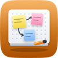
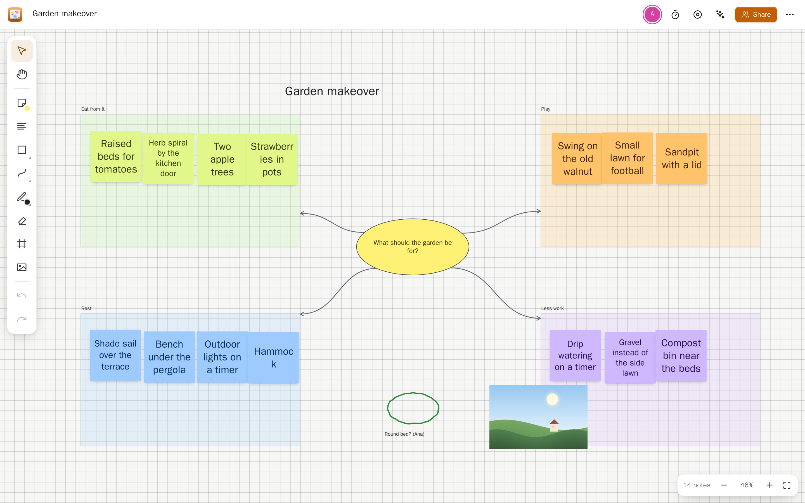
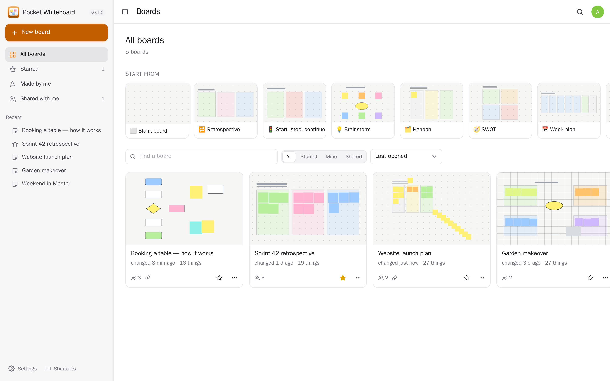
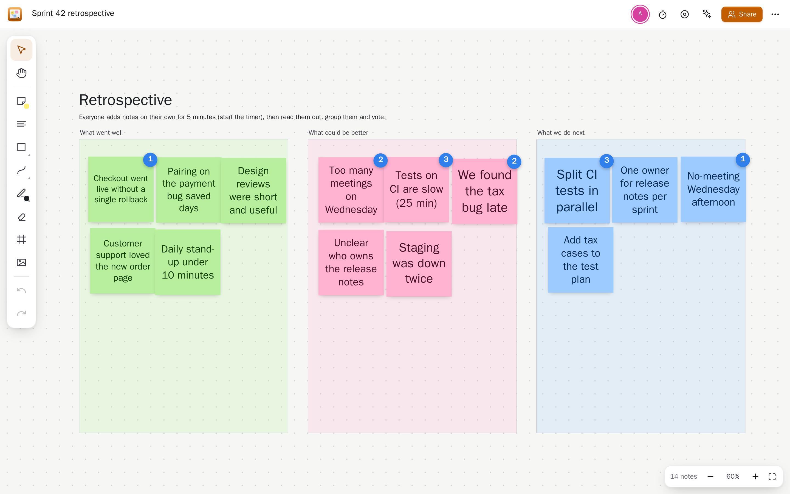
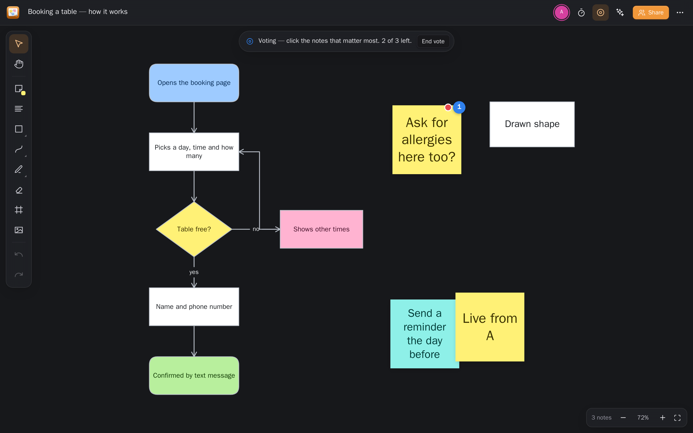
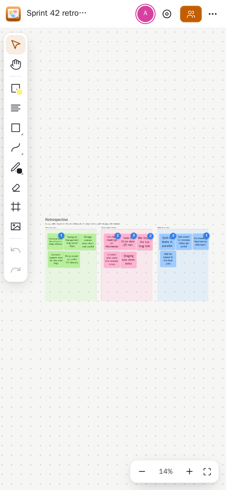

<p align="center"></p>

<h1 align="center">Pocket Whiteboard</h1>
<p align="center">A whiteboard without edges for thinking together: sticky notes, text, shapes, arrows that stay joined, frames, pen drawings and pictures. Everyone on a board sees each change and each other's pointer as it happens. Start a retrospective, brainstorm, kanban or mind map from a template, vote with dots, keep time with a shared timer, let Pocket AI group the notes by theme or sum the board up, and present it frame by frame. Share a board with the people on your box or by a link (no account needed), keep a picture of it, and turn the notes you pick into tasks. Replaces Miro-style boards with one you keep yourself.<br>One Go binary, one SQLite file, one volume. Part of the Pocket apps; works on its own too.</p>

<p align="center">
  <a href="LICENSE"></a>
</p>

<p align="center"></p>

| | |
|---|---|
|  |  |
|  |  |

## What it does

- **Sticky notes** in twelve colours whose text shrinks to fit; double-click anywhere for a new one, Tab for the next one beside it, the **+** on a picked note for one next to it. Paste a list and every line becomes a note.
- **Text, shapes** (rectangle, rounded, circle, diamond, triangle, hexagon, slanted, star), **lines and arrows** (straight, elbow, curved) that stay joined to what they connect, **frames** that carry their contents, a **pen** and highlighter with an eraser, and **pictures** (paste, drop or pick).
- **Together, live**: changes, pointers and what each person has picked show at once; who is here sits in the top bar.
- **Voting** with dots (counts hidden until the end if you like) and results ranked; a **timer** everyone sees, with a chime at the end; **present** frame by frame.
- **Lines up** with the things around it as you drag (or snaps to the grid); resize, lock, bring to front, arrange in a grid, sort by colour, undo and redo.
- **Templates**: retrospective, start-stop-continue, brainstorm, kanban, SWOT, week plan, mind map, journey map.
- **Sharing**: people on this box as editors or viewers; a link for anyone (view or edit) with a QR code.
- **Out**: a PNG of the board or of what is picked, every note as CSV, the whole board as JSON (and back in).
- **With Pocket Core**: sign in with Core; notes become **Pocket Tasks**, a board is kept in **Pocket Notes**, its link goes to **Pocket Chat**, its picture to **Pocket Files**; **Pocket AI** groups notes by theme, sums up and suggests more. Pocket Search, Day and AI can read your boards (`whiteboard:read`) and put notes on them (`whiteboard:write`) once you switch those links on.

## Run it

```sh
make run            # demo boards, no login, http://localhost:8080
```

Or `docker compose up -d` with [docker-compose.yml](docker-compose.yml). Open it and make the first account (that one is the admin). Settings: [docs/configuration.md](docs/configuration.md), API: [docs/api.md](docs/api.md), backup: [docs/backup.md](docs/backup.md), reverse proxy: [docs/reverse-proxy.md](docs/reverse-proxy.md) — the live stream needs `flush_interval -1` behind Caddy.

## Keys on a board

`V` select · `H` or Space move the board · `N` note · `T` text · `S` shape · `L` line · `P` pen · `E` eraser · `F` frame · `I` picture · `⌘Z`/`⇧⌘Z` undo/redo · `⌘D` copy · `Del` delete · `]`/`[` front/back · `⇧1` fit everything · `?` all of them.

## License

MIT © 2026 Aleksandar Bjelosevic
